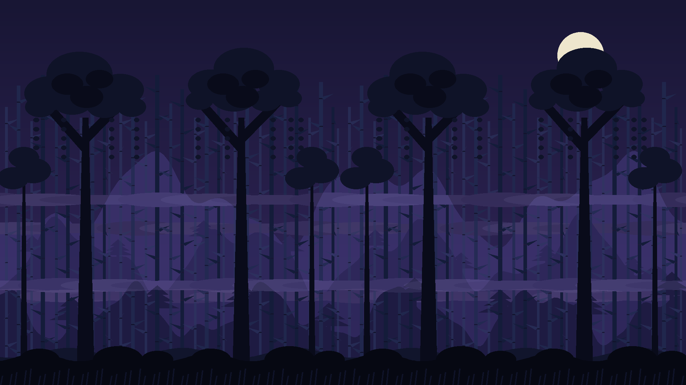
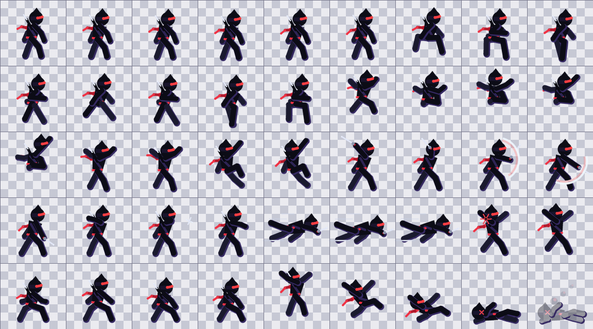
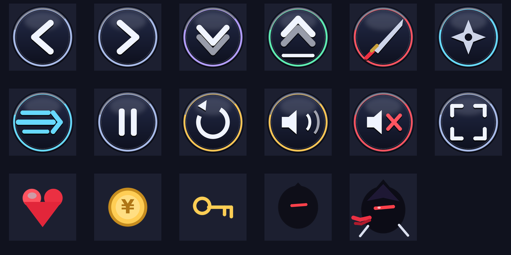

# 🐱‍👤 Shadow Ninja — 2D Platformer


**Ninja Arashi** uslubidagi tezkor 2D platformer: 3 ta level, devordan sakrash, qilich
va shuriken, samuray/kamonchi dushmanlar, oni boss — hamda **telefingizdagi musiqani
o'yin musiqasi sifatida qo'yish** imkoniyati. Butun o'yin bitta `index.html`
faylida — hech qanday build yoki bog'liqliklarsiz.







## ▶️ Ishga tushirish

### GitHub Pages (server, eng oson)

1. Reponi GitHub'ga yuklang (`master` branch).
2. **Settings → Pages → Build and deployment → Source: GitHub Actions** ni tanlang.
3. `master` ga push qiling — `.github/workflows/pages.yml` avtomatik deploy qiladi:
   `https://<username>.github.io/shadow-ninja-game/`

### Lokal kompyuterda

```bash
./run.sh            # http://localhost:8000
```

yoki:

```bash
python3 -m http.server 8000
```

Windows: `start.bat`. Faylni to'g'ridan-to'g'ri brauzerda ochish ham ishlaydi
(`file://`), faqat PWA/offline funksiyalari http(s) talab qiladi.

### Docker

```bash
docker run --rm -p 8080:80 -v "$PWD":/usr/share/nginx/html:ro nginx:alpine
# → http://localhost:8080
```

## 🎵 Telefingizdagi musiqa

O'yin ichidan: **My Music** (asosiy menyu) → **Choose music file** → telefoningizdan
audio fayl tanlang (MP3/M4A/OGG/WAV …). Trek o'yin fonida loop bo'lib chaladi,
pauzada to'xtaydi, jim/o'chirish tugmalari bilan sinxron ishlaydi va **IndexedDB**
orqali qurilmada saqlanib qoladi — qayta kirganda yana tanlash shart emas.
Ovoz balandligi slayder bilan sozlanadi.

## 🎮 Boshqaruv

| Harakat | Klaviatura | Telefon |
| --- | --- | --- |
| Yugurish | ← → / A D | ◀ ▶ tugmalar |
| Enkayish | ↓ / S | ▼ tugma |
| Sakrash ×2 | Space / W / ↑ | JUMP |
| Qilich | J / X | ⚔ tugma |
| Shuriken | K / C | ★ tugma |
| Dash | L / Shift | 💨 tugma |
| Pauza | P / Esc | ⏸ tugma |
| Jim qilish | M | 🔊 tugma |
| Qayta boshlash | R | ↻ tugma |

## ✨ Imkoniyatlar

- 3 level: **Bamboo Grove → Rooftops of Kage → The Shogun Keep** (oni boss)
- Double jump, wall-slide/jump, dash, crouch, checkpointlar, 3 ta jon
- Samuray (bloklaydi), kamonchi (o'q uzadi), oni boss (slam, roar)
- Animatsiyalangan sprite'lar, parallax fon, particles, screen shake
- 2026 glassmorphism UI, HUD, menyular; mobil to'liq ekran rejimi
- PWA: telefonga "ilova" sifatida o'rnatiladi, offlayn ishlaydi (`sw.js`)

## 📁 Struktura

```
.
├── index.html            # butun o'yin (bitta fayl, barcha art ichiga joylangan)
├── manifest.webmanifest  # PWA manifest
├── sw.js                 # service worker (offline)
├── assets/
│   ├── sprites/          # ninja/samurai/archer/oni sprite sheets (+ JSON)
│   ├── backgrounds/      # 3 parallax qatlam + tileset
│   ├── ui/               # tugma va HUD rasmlari
│   └── video/            # intro video (MP4)
├── tools/                # art generatorlari (Python + Pillow)
│   ├── generate_sprites.py
│   ├── generate_backgrounds.py
│   ├── generate_ui.py
│   └── render_intro.py   # kerak: opencv-python
└── .github/workflows/pages.yml
```

> `index.html` — reliz formati: barcha rasmlar data-URI ko'rinishida faylning
> o'zida. `assets/` dagi PNG'lar — o'sha rasmlarning manba nusxalari;
> o'yin ularni o'qimaydi, generatorlar bilan ishlash uchun saqlanadi.

## 🛠 Art'ni qayta yaratish

```bash
pip install Pillow opencv-python   # opencv faqat intro video uchun
python3 tools/generate_sprites.py
python3 tools/generate_backgrounds.py
python3 tools/generate_ui.py
```

## 📜 Litsenziya

MIT — [LICENSE](LICENSE) fayliga qarang.
